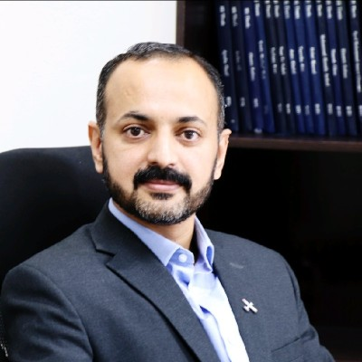

[Home](https://shahzadrasool.github.io/) · [XR-HIVE](https://shahzadrasool.github.io/hive) · [Publications](https://shahzadrasool.github.io/publications)

# Dr. Shahzad Rasool

**Associate Professor · School of Interdisciplinary Engineering and Sciences (SINES)**
National University of Sciences and Technology, Islamabad

*Virtual reality · Haptics · Human-computer interaction · Brain-computer interfaces*

  

📞 +92 51 9085 5737

---

## At a glance

| 🎓 At NUST | 📄 Journal articles | 🎤 Conference papers | 💼 Funded projects | 💰 Funding raised | 🧑‍🔬 Lab alumni |
|:---:|:---:|:---:|:---:|:---:|:---:|
| **10 years** | **13** | **15** | **8** | **PKR 73,505,783** | **29** |

**Jump to:** [Profile](#profile) · [Research](#research-focus) · [Latest papers](#latest-publications) · [Experience and education](#experience-and-education) · [Teaching](#teaching) · [Contact](#contact)

## Profile

Dr. Shahzad Rasool is an Associate Professor at the [School of Interdisciplinary Engineering and Sciences (SINES)](http://www.sines.nust.edu.pk/), [National University of Science and Technology (NUST)](http://www.nust.edu.pk), since August 2016. He received his Ph.D. from [Nanyang Technological University (NTU)](http://www.ntu.edu.sg), Singapore, in 2014, his M.Sc. in [Communication Engineering](https://www.ei.tum.de/en/ei/studium/msce/) from [Technische Universität München (TUM)](https://www.tum.de/en), Germany, in 2009, and his B.Sc. in Electrical Engineering from the [University of Engineering and Technology (UET)](http://www.uettaxila.edu.pk), Taxila, Pakistan, in 2006.

In 2008 he worked as a research intern at DOCOMO Communications Laboratories Europe, Munich. From 2014 to 2016 he was a Research Fellow at the [Immersive Mathematics Lab](http://www3.ntu.edu.sg/home/assourin/research) of [Fraunhofer IDM @ NTU](http://www.fraunhofer.sg), Singapore.

His recent research focuses on applications of immersive interaction. His interests include haptics, virtual reality, HCI and brain-computer interfaces.

- 🏆 Top Performer Award, NUST (2022)
- 🏆 School Best Researcher Award, SINES (2022)
- 🏆 School Best Innovator Award, SINES (2022)
- 🏆 School Best Teacher Award, SINES (2022)

## Research focus

The [XR-HIVE](https://shahzadrasool.github.io/hive) lab works across four areas. Each links to the related papers.

| Area | What we do | Papers |
|:---|:---|:---:|
| **🥽 Virtual and Augmented Reality** | Immersive visualization techniques for various applications. | [10](https://shahzadrasool.github.io/publications#vr-and-ar) |
| **✋ Haptic Interaction** | Modeling high-realism force feedback for various applications. | [14](https://shahzadrasool.github.io/publications#haptics) |
| **🧠 Brain Computer Interfaces** | Cognitive state estimation and neurofeedback for enhanced experiences. | [4](https://shahzadrasool.github.io/publications#brain-and-cognition) |
| **🖼️ Computer Graphics / Vision** | Out-of-the-box solutions for conventional problems in CG and CV. | [17](https://shahzadrasool.github.io/publications#graphics-and-vision) |

## Latest publications

- **The influence of audiovisual design on emotional responses and presence in virtual reality environments** *(2026)*  
  Displays · `IF 3.4` · [DOI](https://doi.org/10.1016/j.displa.2026.103395)
- **Low Cost 3D Motion Capture of Rapid Maneuvers Using a Single High Speed Camera** *(2025)*  
  Computer Animation and Virtual Worlds · `IF 1.7` · [DOI](https://doi.org/10.1002/cav.70070)
- **Enhancing Energy Conservation Behaviors Through Audio, Visual, and Social Cues in Virtual Reality** *(2025)*  
  The Visual Computer · `IF 3.0` · [DOI](https://doi.org/10.1007/s00371-025-04003-7)
- **VR Stereo Thrills & Spills: An Immersive Virtual Reality Game for Enhancing Student Understanding of Stereoisomerism** *(2025)*  
  Journal of Chemical Education · `IF 2.5` · [DOI](https://doi.org/10.1021/acs.jchemed.5c00112)
- **Beyond User Control: Exploring Hint System Design and Player Experience in Puzzle Games** *(2025)*  
  2025 International Conference on Communication Technologies (ComTech) · [DOI](https://doi.org/10.1109/ComTech65062.2025.11034626)

➡️ **[All 28 publications](https://shahzadrasool.github.io/publications)**, searchable by topic, with a [BibTeX file](https://shahzadrasool.github.io/publications.bib).

## Experience and education

**Experience**

- **Associate Professor**, National University of Sciences and Technology (NUST), Pakistan (School of Interdisciplinary Engineering and Sciences (SINES))  
  `Aug 2016 – Present`
- **Research Fellow**, Fraunhofer IDM @ NTU, Singapore (Visual Immersive Haptic Mathematics (VIHAMAT) Lab)  
  `Dec 2012 – Aug 2016`

**Education**

- **PhD, Computer Engineering**, Nanyang Technological University (NTU), Singapore  
  `2010 – 2014`
- **MSc, Communication Engineering**, Technical University of Munich (TUM), Germany  
  `2007 – 2009`
- **BSc, Electrical Engineering**, University of Engineering & Technology (UET), Taxila  
  `2003 – 2006`

## Teaching

<b>35 course offerings since 2016</b> (click to expand)

**Undergraduate**

| Code | Course | Terms |
|:---|:---|:---|
| CS-261 | Human Computer Interaction | Spring 2025 |
| CS-365 | Virtual and Augmented Reality | Fall 2023, 2024, 2025 |
| BI-434 | Virtual Reality | Spring 2026 |

**Postgraduate**

| Code | Course | Terms |
|:---|:---|:---|
| CSE-867 | Virtual Reality | Fall 2017–2023, 2025 |
| CSE-865 | 3D Geometric Modeling and Reconstruction | Spring 2018–2024 |
| CSE-868 | Human Computer Interaction | Spring 2018–2022, 2025 |
| EE-851 | Advanced Digital Communication Systems | Fall 2017–2020 |
| CSE-832 | Communications Systems and Networks | Fall 2016, Summer 2017 |
| SYSE-805 | System Engineering Project Management | Spring 2017 |
| RM-898 | Research Methodology | Fall 2016, Spring 2017 |

## Contact

| | |
|:---|:---|
| ✉️ **Email** | [shahzad.rasool@sines.nust.edu.pk](mailto:shahzad.rasool@sines.nust.edu.pk) |
| 📞 **Phone** | +92 51 9085 5737 |
| 🏛️ **Address** | School of Interdisciplinary Engineering and Sciences (SINES), National University of Sciences and Technology, Islamabad |
| 🧪 **Lab** | [XR-HIVE](https://shahzadrasool.github.io/hive) |
